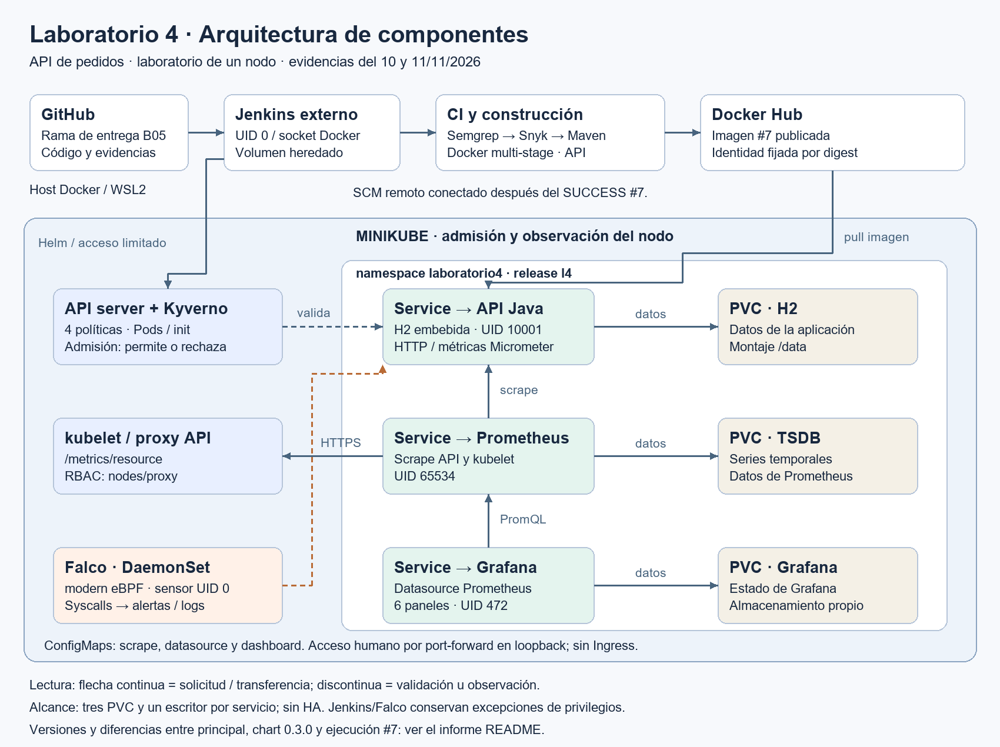

# Laboratorio 4 — API de pedidos: integración DevOps y DevSecOps

Informe técnico integrador · 11 de noviembre de 2026.

El trabajo integra contenerización, despliegue, CI/CD, observabilidad y seguridad
sobre una API Java de productos y pedidos. Jenkins #7 completó las seis etapas,
publicó una imagen y desplegó la aplicación mediante Helm. Los análisis posteriores
de esa imagen y las pruebas aisladas del chart amplían esa evidencia. Persisten
hallazgos y diferencias de alcance respecto de la consigna, detallados en este
informe; no se declara conformidad global de la entrega.

Los resultados proceden de ejecuciones conservadas del 10 y 11/11/2026. Esta
redacción reutiliza sus registros y no acredita salud actual de los servicios.
El informe y su diagrama se prepararon en B06/L4-12. La rama de revisión
[trabajo-integrador-4](https://github.com/FacundoCoria/EntregableDevops2/tree/trabajo-integrador-4)
reúne código, Jenkinsfile, scripts, reportes e informe, preparada el 13/11/2026
desde B05 (`d7b1a5fc714f6dceecc16eda6f1795d02022d218`). La integración a
`main` queda a cargo del compañero después de revisar la entrega. La rama
`métricas-nuevas` se mantiene separada y no está incorporada aquí.

## 1. Descripción general del proyecto

La aplicación permite administrar productos y crear y consultar pedidos mediante
una API REST. Usa Spring Boot, Maven, persistencia H2 embebida y Micrometer.
El componente propio desplegable es la API; no hay frontend propio ni servidor
de base de datos independiente. Prometheus y Grafana son servicios auxiliares;
Kyverno y Falco incorporan controles de admisión y detección en ejecución.

El código está en [pedidos-api/pedidos-api](pedidos-api/pedidos-api/).
La implementación conserva las funcionalidades del proyecto y añade una entrega
automatizada, almacenamiento persistente, métricas de infraestructura y negocio,
y evidencias que permiten diferenciar intentos fallidos de verificaciones exitosas.
El entorno es un laboratorio local de un nodo, con Docker/WSL2 y Minikube.

Documentación para reproducir el trabajo:

- [Inicio, tráfico, acceso y limpieza del entorno existente](scripts/l4/GUIA.md).
- [Creación y eliminación de un clúster descartable](scripts/l4/B04-REPRODUCCION.md).
- [Índice de evidencias técnicas](reports/ESTADO-EVIDENCIAS-L4.md).
- [Entrega Git y configuración Jenkins](docs/ENTREGA-B05.md).
- [Dashboard adjunto, en JSON](grafana/dashboard.json).

## 2. Arquitectura final



[Diagrama vectorial](docs/arquitectura-l4.svg) ·
[Fuente editable Mermaid](docs/ARQUITECTURA-L4.mmd).
Las flechas indican solicitudes, transferencia o consulta; las líneas discontinuas
representan configuración, validación o detección, según su etiqueta.

Jenkins se ejecuta fuera del clúster, en un contenedor existente del curso.
Clona código, analiza, compila, construye y publica la imagen en Docker Hub.
Helm envía los recursos a Kubernetes; Kyverno valida la admisión de Pods del
namespace `laboratorio4`. El nodo obtiene la imagen del registro y ejecuta API,
Prometheus y Grafana, cada uno con Service y PVC. Falco observa eventos del nodo
mediante modern eBPF y produce alertas; no bloquea las acciones de la aplicación.

Prometheus consulta `/actuator/prometheus` de la API y obtiene CPU y memoria de
Pods a través de `/metrics/resource` del kubelet usando el proxy del API server.
Grafana consulta el Service interno de Prometheus. ConfigMaps provisionan scrape,
datasource y dashboard. El acceso humano usa port-forward en loopback; no se
incluye Ingress porque no se publicó un acceso externo en este alcance.

### Contenedores, almacenamiento y Helm

El [Dockerfile](pedidos-api/pedidos-api/Dockerfile) de la API usa dos etapas:
JDK Temurin para Maven y pruebas, y JRE Temurin para ejecutar únicamente el JAR.
Ambas bases 21.0.13+9 están fijadas por digest. El runtime usa UID/GID
`10001:10001`, sin shell de login, con datos en `/data`. Las pruebas de L4-01 y
L4-03 acreditan salud, métricas y persistencia H2 después de recrear el contenedor
o Pod; no se repitieron al redactar este informe.

| Componente | Versión observada | Usuario y persistencia |
|---|---|---|
| API | Imagen Jenkins #7, identificada debajo | UID 10001; PVC H2 |
| Prometheus | v3.16.0, digest en values | UID 65534; PVC TSDB |
| Grafana | 13.0.12, digest en values | UID 472; PVC Grafana |
| Kyverno | v1.20.0-rc.4, chart 3.10.0-rc.4 | UID 65534 según runtime; una réplica |
| Falco | 0.45.2, chart 9.2.2 | Sensor UID 0 y capacidades de host |
| Jenkins | Core 2.568.3, imagen heredada `ucu-devops/jenkins:lts` | UID 0, socket Docker y volumen heredado |

El [inventario B02](reports/l4-11b/b02-componentes.md) verifica versiones y
usuarios. Se consumen imágenes oficiales para las herramientas, sin Dockerfiles
derivados vacíos. Esta decisión no acredita el requisito literal de Dockerfile
por herramienta ni no root global: Jenkins y Falco son excepciones explícitas.
El lock de Jenkins comprueba su imageId local antes del inicio; no vuelve
inmutable la etiqueta `lts` ni reproduce plugins, credenciales y capa escribible.

El [chart local 0.3.0](pedidos-api/pedidos-api/helm-chart/README.md) contiene
16 recursos: tres Deployment, tres Service, tres PVC, cuatro ConfigMap,
ServiceAccount, ClusterRole y ClusterRoleBinding. Incluye `values.yaml` y
`values-dev.yaml`; permite configurar imagen, recursos, almacenamiento y puertos
HTTP entre 1024 y 65535. Las réplicas admitidas son 0 o 1, con estrategia Recreate
y un escritor por PVC. H2 embebida y el almacenamiento de monitoreo no ofrecen HA.

El despliegue inicial mediante `helm install` se acreditó en L4-03. Jenkins #7
desplegó el chart 0.2.1, revisión 8; el principal quedó en revisión 10 por L4-10 y
se preservó en B04. El chart 0.3.0 se probó después en releases/perfiles temporales:
tres lint, cuatro renders, 15 rechazos de valores inválidos, dos dry-run de
servidor y servicios reales con puertos alternativos aprobados en
[B03](reports/l4-11b/b03-helm.md). La variante con cero réplicas solo se renderizó.
No se atribuye a #7 una ejecución del chart posterior ni al principal un upgrade
que no se realizó. `appVersion: l4-01` es metadato histórico; la imagen efectiva
depende de los valores del release.

### Calidad de la imagen publicada

La imagen que produjo #7 es `brunovitola/pedidos-api-l4:l4-7-0f47780b51b3`.
Su identidad analizada y recuperada por pull en B01 es:

```text
brunovitola/pedidos-api-l4@sha256:48b65d95763c2a1eb6727f9b22b78fc27509f79b62a7b87903cea87a4aee41d9
```

El [reporte B01](reports/l4-11b/image-analysis.md) registra ocho capas y
150.630.157 bytes según Docker (150,63 MB decimales). Dive Windows 0.13.1 mide
346.922.869 bytes de archivos descomprimidos y 98,6734 % de eficiencia; son
medidas distintas del tamaño de descarga. Fragmento de [Dive CI](reports/l4-11b/dive-ci.txt):

```text
  efficiency: 98.6734 %
  wastedBytes: 5465165 bytes (5.5 MB)
Result:PASS [Total:3] [Passed:2] [Failed:0] [Warn:0] [Skipped:1]
```

Multi-stage evita entregar Maven, fuentes y JDK. El JRE domina el tamaño;
`useradd --no-log-init` o un runtime menor son oportunidades de optimización
que requieren una construcción nueva y pruebas de compatibilidad. El PASS de
Dive se refiere a sus reglas de eficiencia; una regla está desactivada y no
constituye aprobación de seguridad.

## 3. Pipeline implementado

El [Jenkinsfile](Jenkinsfile) define seis etapas y archiva evidencias aun ante
fallos. Deshabilita ejecuciones concurrentes y limita la duración a 45 minutos.

| Etapa | Implementación y resultado comprobado en #7 |
|---|---|
| 1. Clonación | Git clone y checkout del commit; huellas POM/Dockerfile y versiones de herramientas |
| 2. Semgrep | Dos reglas Java; cero hallazgos, análisis estricto con error ante coincidencias |
| 3. Snyk y gate | Maven con dependencias test; gate PASS por cero críticos, con hallazgos residuales |
| 4. Construcción y pruebas | Maven `clean verify` y árbol de dependencias; una prueba sin fallos ni errores |
| 5. Imagen y publicación | Build multi-stage, verificación USER, login con credencial y push a Docker Hub |
| 6. Despliegue | Helm mediante kubeconfig limitado; espera de disponibilidad y salud API |

Fragmento de [verification.json de #7](reports/l4-09/integral-7/verification.json),
con campos intermedios omitidos:

```json
{
  "build": 7,
  "result": "SUCCESS",
  "duration_ms": 97054,
  "source_commit": "0f47780b51b3711763d6aebf4a9791d5d1edee28",
  "helm_revision": 8,
  "api_status": "UP",
  "ready_pods": 3
}
```

Ese éxito corresponde a un snapshot Git local aislado. En B05 se publicó la rama
de entrega y Bruno configuró **Pipeline script from SCM** con URL
`https://github.com/FacundoCoria/EntregableDevops2.git`, rama
`lab4/b05-consolidacion-entrega` y Script Path `Jenkinsfile`. Se comprobaron SCM,
defaults y clonación desde GitHub dentro de Jenkins, con 725 reportes idénticos.
Main `ee6bc93` quedó reconciliado en la rama, sin modificar main. La conexión
remota posterior no equivale a un nuevo build integral; véase
[consolidación B05](reports/l4-11b/b05/CONSOLIDACION.md).

El [gate Snyk](ci/gate-snyk.py) distingue errores técnicos de hallazgos:
un error del scanner no permite continuar; un resultado válido con críticos
bloquea; uno sin críticos puede pasar aunque Snyk termine con exit 1 por otras
severidades. #3 demostró el bloqueo real antes de las correcciones:

```json
{"scan_exit_code": 1, "gate": "BLOCKED_CRITICAL"}
```

Es una selección de campos de [gate-summary.json #3](reports/l4-09/security-3/gate-summary.json),
que registra siete críticos. El [resultado #7](reports/l4-09/integral-7/gate-summary.json)
mantiene exit 1 y gate PASS con cero críticos. Este criterio no bloquea por altas.
Las credenciales Snyk/Docker Hub se obtienen de Jenkins; el token Kubernetes
preparado tenía vigencia de 24 h. Una ejecución futura exige revisar esa vigencia;
no se declara acceso permanente.

## 4. Métricas y dashboard de Grafana

El [dashboard exportado adjunto](grafana/dashboard.json), UID
`l4-observabilidad`, tiene seis paneles, refresco de cinco segundos y ventana
inicial de quince minutos. Se provisiona con el chart junto al datasource.

| Panel | Consulta o interpretación |
|---|---|
| Solicitudes HTTP por segundo | Suma de `rate(http_server_requests_seconds_count)` para `/api/*`, excluye salud y scrapes |
| Latencia HTTP promedio | Tasa de la suma de duraciones dividida por tasa del contador; segundos por solicitud |
| CPU por pod | `rate(pod_cpu_usage_seconds_total)`; núcleos |
| Memoria por pod | `pod_memory_working_set_bytes`; bytes |
| Pedidos creados por producto | `pedidos_creados_total`; contador de negocio desde el arranque |
| Pedidos creados por segundo | Tasa del contador de negocio por producto |

L4-04 comprobó ambos targets UP, consultas directas y mediante el datasource y
correlación de 17 pedidos con el contador; Bruno confirmó visualmente los seis
paneles. Tras corregir el OOM de Grafana se completaron 360 consultas durante
cinco minutos sin reinicios. Esos registros originales se conservan fuera del
repositorio en `handoffs/evidencias_l4_04_2026-11-10/` de la carpeta general;
la [guía de observabilidad](pedidos-api/pedidos-api/OBSERVABILIDAD-L4.md)
describe el procedimiento. B03/B04 acreditan después targets UP y servicios
saludables; [L4-10](reports/l4-10/VERIFICACION.md) conserva tráfico correlacionado.

El generador comprueba que el incremento del contador coincide con los pedidos
creados; su tráfico es demostrativo y no mide capacidad. Los contadores en memoria
se reinician con Java y no reconstruyen pedidos históricos guardados en H2.
Sin solicitudes, la latencia puede no tener valor; los minutos de espera del
negocio no son latencia HTTP. El catálogo complementario de métricas está en
[Métricas de pedidos](docs/METRICAS-PEDIDOS.md).

Prometheus usa un ServiceAccount con GET `nodes/proxy` del único nodo observado.
RBAC no restringe ese permiso a la ruta de métricas: alcanza otras rutas del
proxy. Los filtros de series limitan ingestión, no autorización. Se documenta
esta concesión del laboratorio; no se extrapola el diseño a un clúster multinodo.

## 5. Resultados de análisis de seguridad

### Semgrep: reglas Java

Semgrep 1.184.0 OSS ejecutó `command-injection-formatted-runtime-call` (CWE-78)
y `jdbc-sqli` (CWE-89) sobre ocho fuentes Java de producción. Las dos pruebas
de reglas pasaron. Fragmento del [reporte exigido](reports/semgrep-report.txt):

```text
Ran 2 rules on 8 files: 0 findings.
```

No se requirieron correcciones Java en este alcance. `src/test/java` quedó
excluido por los patrones predeterminados; cero coincidencias no acredita
seguridad universal, autenticación ni análisis completo de todos los flujos.
Los reportes históricos de siete alertas Docker/Kubernetes y su corrección se
conservan separados, con alcance distinto.

### Snyk: dependencias Maven

El [reporte inicial](reports/snyk-report.txt) conserva diagnóstico y propuestas;
la [comparación](reports/snyk-comparison.md) enlaza JSON originales y posteriores.
Ambos análisis incluyen test y 130 dependencias.

| Ejecución | Críticas | Altas | Medias | Bajas |
|---|---:|---:|---:|---:|
| L4-06 inicial / gate #3 | 7 | 11 | 24 | 2 |
| Jenkins #7 posterior | 0 | 1 | 8 | 1 |

Se aplicaron Tomcat 11.0.27 y Jackson BOM 3.1.8 en L4-09, con compilación,
prueba y ejecución integral. Los siete IDs críticos y diez altos iniciales
dejaron de aparecer en #7. Persiste `SNYK-JAVA-ORGGLASSFISHJAXB-20883142`,
XXE en jaxb-core 4.0.9, sin versión corregida informada en ese resultado.
Quedan pendientes seguimiento del proveedor y revisión del uso/configuración
XML antes de justificar aplicabilidad. No se probó alcanzabilidad ni explotación;
los ocho medios y un bajo también permanecen en seguimiento.

### Trivy: sistema operativo y runtime de la imagen

Trivy 0.76.1 analizó por digest la imagen publicada #7, con todas las
severidades y sin omitir hallazgos sin parche. El [JSON](reports/l4-11b/trivyreport.json)
y la [tabla](reports/l4-11b/trivyreport.txt) respaldan esta comparación:

| Imagen | Críticas | Altas | Medias | Bajas | Filas |
|---|---:|---:|---:|---:|---:|
| L4-02 inicial | 4 | 7 | 25 | 16 | 52 |
| Publicada #7, B01 | 0 | 2 | 23 | 16 | 41 |

Las 41 filas actuales son Ubuntu y representan 30 IDs distintos. Los once
pares paquete/ID Java iniciales ya no aparecen. Los dos HIGH corresponden a
`CVE-2026-109518` en apt y libapt-pkg6.0 2.4.14; Trivy informa
2.4.15ubuntu0.1 como versión corregida. Se propone actualizar la base o paquetes,
reconstruir con nueva identidad, probar API/JSON/H2/métricas y reescanear.
No se aplicó esa corrección en B01 ni al redactar el informe.

Trivy no señaló la alta JAXB que Snyk conserva. Sus catálogos y alcances difieren:
Snyk incluye test y Trivy examina la imagen runtime. No se suma el número de
filas entre herramientas ni se declara falso positivo o resuelto el hallazgo
por esa diferencia. Exit 0 de Trivy acredita ejecución, no ausencia de hallazgos.

### Kyverno: admisión de Pods

Se instalaron cuatro ValidatingPolicy CEL, Ready/Deny con tratamiento Fail:
`l4-deny-latest-images`, `l4-require-container-resources`,
`l4-disallow-root-containers` y `l4-disallow-privileged-containers`.
Exigen imagen etiquetada distinta de latest o digest, requests/limits CPU y
memoria, ejecución no root y ausencia de contenedores privilegiados.

El [log exigido](reports/kyverno-validation.log) conserva 16/16 casos de
admisión, cuatro rechazos con create real y un Pod conforme que terminó como
UID 10001, retirado al finalizar. Fragmento literal del mensaje de rechazo:

```text
Policy l4-disallow-root-containers failed: runAsNonRoot efectivo debe ser true y runAsUser no puede ser 0.
```

El [alcance documentado](pedidos-api/pedidos-api/security/kyverno/README.md)
cubre Pods e initContainers de `laboratorio4`; no todos los Pods del clúster ni
ephemeralContainers. La versión es candidata y usa una réplica. La regla de
imagen permite identidad por digest, incluso una referencia `:latest@sha256:...`;
ese caso no fue probado. No se afirma prohibición literal de toda aparición
de latest ni cobertura universal. Estas diferencias se conservan en B09.

### Falco: detección durante la ejecución

Falco 0.45.2, instalado con chart oficial 9.2.2 y modern eBPF, detectó una
lectura deliberada de `/etc/shadow` mediante `cat` directo con `kubectl exec`,
sin shell ni TTY. El archivo era un fixture ficticio montado desde ConfigMap,
sin credenciales reales; no se trató de un incidente real.

Fragmento del resultado de correlación incluido en
[falco-event.log](reports/falco-event.log), con otros campos omitidos:

```json
{
  "eventTimeUtc": "2026-11-11T14:40:58.000012516Z",
  "rule": "Read sensitive file untrusted",
  "priority": "Warning",
  "matchedEvents": 1,
  "controlMatchedSensitiveEvents": 0,
  "shellOpened": false,
  "syntheticFixture": true
}
```

Se correlacionaron tiempo, Pod, contenedor, UID 10001 y comando. La lectura de
`/etc/hostname` de control no produjo esa alerta. Pod y ConfigMap de prueba se
eliminaron. La [explicación del evento](reports/falco-event.md) conserva
procedimiento y límites. El sensor corre como UID 0 con capacidades BPF,
SYS_RESOURCE, PERFMON y SYS_PTRACE; `leastPrivileged` no significa no root.

## 6. Problemas encontrados y soluciones adoptadas

| Problema observado | Tratamiento y evidencia |
|---|---|
| Grafana OOMKilled con límite 256 MiB | Request 512 MiB y límite 1 GiB; L4-04 comprobó cinco minutos de consultas sin reinicios. No es dimensionamiento productivo. |
| Snyk #2 falló por permiso de `mvnw`, sin JSON válido | Permiso ejecutable corregido; scan posterior válido. El error inicial no se cuenta como análisis sin vulnerabilidades. |
| Siete críticos bloquearon #3 | Actualizaciones Tomcat/Jackson, pruebas y análisis posterior; #7 completa con cero críticos y residuales declarados. |
| #5 cancelado durante push; #6 falló al intentar modificar RBAC mediante Helm | Cancelación y fallo conservados; despliegue ajustado a diff cliente/espera legacy con Helm 4 sin ampliar permisos. Recuperación separada y luego #7 SUCCESS. |
| Puertos y réplicas Helm fijos | Chart 0.3.0 parametrizado y probado en B03; réplicas limitadas a 0/1 por almacenamiento, sin prometer HA. |
| Reproducción Kubernetes y retiro de seguridad incompletos | B04 crea perfil nuevo, prueba reinicio frío y H2, retira seguridad/datos y elimina perfil y volumen; segundo ciclo estable PASS. |
| Primer inicio B04 falló al editar un script mientras Bash lo leía | Se guardó exit 127 y se repitió con archivo estable; la recuperación y segundo ciclo se conservan por separado. |
| Riesgo de borrar otro perfil/PVC o perder el contexto seleccionado | Verificación de identidad/propiedad y restauración del contexto; rechazos negativos y eliminación dedicada probados en B04. |
| Código/reportes locales y Jenkins con fuente local | B05 publica rama, reconcilia main y conecta SCM/defaults; clonación remota verificada, sin atribuirle otro éxito integral. |

### Operación y reproducción documentadas

Los scripts Bash de [la guía operativa](scripts/l4/GUIA.md) inician el stack,
instalan Kyverno y Falco mediante `--security`, generan pedidos correlacionados,
abren accesos locales y limpian recursos con alcance explícito. Prometheus y
Grafana se despliegan directamente mediante el chart de la aplicación;
no se usa Prometheus Operator. Los comandos siguientes son instrucciones de
operación, no ejecuciones realizadas durante la redacción:

```bash
# Desde la raíz del repositorio, con los prerrequisitos de la guía disponibles.
bash scripts/l4/start.sh --jenkins-existing --security
bash scripts/l4/traffic.sh
bash scripts/l4/access.sh
```

`start.sh` instala/actualiza recursos y puede llevar el principal al chart local
0.3.0; no es una consulta de estado. `--jenkins-existing` reutiliza Jenkins tras
comprobar su imagen; falla si falta y no recrea plugins/jobs/credenciales.
Bruno abre las direcciones locales que muestra `access.sh`.

La limpieza por defecto solo genera un plan. Las modalidades de aplicación,
purga de datos y retiro de seguridad requieren confirmación de contexto/namespace/
release y se explican en la guía. Los PVC se conservan salvo purga explícita.
El retiro Helm puede dejar namespaces, algunas CRD y hooks completados.
La eliminación completa de esos recursos se probó sobre el perfil descartable
`minikube-l4-b04`, no destruyendo el principal compartido.

Fragmento de [final-cycle.json B04](reports/l4-11b/b04/final-cycle.json):

```json
{
  "result": "PASS",
  "create_with_final_scripts": true,
  "delete_with_live_workloads": true,
  "main_preserved": true,
  "previous_files_unchanged": 525
}
```

La [verificación B04](reports/l4-11b/b04-reproduccion.md) acredita recuperación
de servicios y targets tras reinicio frío, persistencia del producto H2,
limpieza de aplicación/datos/seguridad y ausencia final del perfil, contenedor y
volumen Docker dedicados. Docker y CLI estaban preinstalados. Aprovisionamiento
de Jenkins desde cero y borrado de su volumen heredado permanecen pendientes;
no se declara reproducción o limpieza global de toda la máquina.

## 7. Conclusiones generales y oportunidades de mejora

El laboratorio demuestra una cadena CI/CD funcional y controles complementarios:
Semgrep revisa patrones del código, Snyk dependencias, Trivy la imagen, Kyverno
la admisión y Falco eventos en ejecución. El bloqueo de #3 y el éxito posterior
de #7 muestran el efecto de las correcciones sobre el flujo. El dashboard combina
comportamiento HTTP, consumo de recursos y pedidos creados, con tráfico
correlacionado. Las pruebas aisladas amplían parametrización, recuperación y
limpieza sin destruir el entorno principal.

Los resultados son verificables dentro de sus alcances. Una prueba Maven,
dos reglas Java, un nodo y una alerta sintética no demuestran cobertura total,
resiliencia productiva ni ausencia de vulnerabilidades. La entrega conserva
estos pendientes concretos:

- **B02:** resolver conformidad literal de Dockerfile por herramienta y migrar
  Jenkins a un diseño no root con agente de build aislado; documentar y probar
  plugins, trabajos, permisos y credenciales.
- **B04 global:** reproducir Jenkins desde cero y definir su retiro; la
  reproducción y eliminación Kubernetes aisladas ya están verificadas.
- **B07:** tratar la alta JAXB y los hallazgos medios/bajo de Snyk, y los dos
  HIGH Ubuntu y otros niveles de Trivy; reconstruir y reescanear si se corrigen.
- **B09:** evaluar alcance de Kyverno, versión estable, disponibilidad y
  referencias latest con digest antes de afirmar cumplimiento global.
- **Revisión e integración:** revisar la rama `trabajo-integrador-4`, incluido
  este informe y sus diagramas, antes de integrar a `main`. La publicación
  documental amplía B05 y no acredita una nueva ejecución del pipeline.

Como evolución, externalizar H2 permitiría revisar escalado/HA con otro diseño
de datos. Un entorno multinodo exige revisar métricas y permisos. Reducir el
runtime y fijar artefactos transitivos de seguridad mejoraría tamaño y
reproducibilidad, sujeto a pruebas nuevas. Ninguna de estas propuestas se
presenta como implementación realizada.

El [índice de evidencias](reports/ESTADO-EVIDENCIAS-L4.md) conserva rutas de
resultados iniciales y posteriores. Los fragmentos seleccionados aquí respaldan
la lectura del informe; los registros completos permiten revisar sus límites.
